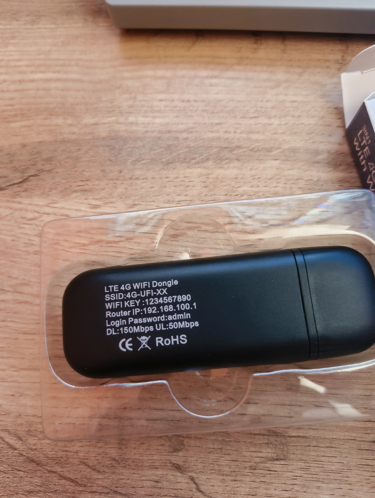
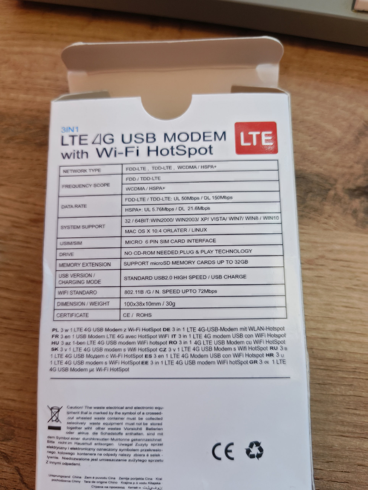

# Модем и характеристики

Эта страница описывает первый экземпляр и его фотографии. Второй подключённый UFI имеет другую прошивку и отдельную [инструкцию и таблицу идентификации](14-second-modem.md); его установщик и APK отличаются.

Проект превращает USB LTE-модем с Android в локальный приёмник и архив СМС. Компьютер подключается по USB RNDIS, открывает HTTP-страницу и обслуживает устройство через USB ADB. Интернет через SIM для этой задачи не нужен. Сотовое радио остаётся включённым: авиарежим помешал бы приёму СМС.

## Фотографии

Фото исходного экземпляра и упаковки предоставлены владельцем. Заводские пароли на наклейке относятся к штатному режиму устройства.

## Что указано на упаковке и наклейке

| Параметр | Заявленное значение |
| --- | --- |
| Название | LTE 4G USB Modem with Wi-Fi HotSpot, 3 in 1 |
| Сети | FDD-LTE, TDD-LTE, WCDMA / HSPA+ |
| LTE | До 150 Мбит/с приём, до 50 Мбит/с передача |
| HSPA+ | До 21,6 Мбит/с приём, до 5,76 Мбит/с передача |
| Wi-Fi | 802.11 b/g/n, до 72 Мбит/с |
| USB | USB 2.0 High Speed, питание через USB |
| SIM | На упаковке: «MICRO 6 PIN SIM CARD INTERFACE» |
| microSD | До 32 ГБ |
| Размер и масса | 100 × 38 × 10 мм, 30 г |
| Заявленные ОС | Windows 2000/2003/XP/Vista/7/8/10, 32/64 bit; Mac OS X 10.4+; Linux |
| Штатный IP | 192.168.100.1 |
| Заводской SSID | 4G-UFI-XX |
| Заводской ключ Wi-Fi | 1234567890 |
| Заводской пароль панели | admin |

Это сведения с упаковки, а не результаты испытаний скоростей или совместимости со всеми перечисленными ОС. Диапазоны LTE, точный производитель, аппаратная ревизия и допустимый ток питания на этих фото не указаны. Не подбирайте прошивку по одному внешнему виду или названию UFI103.

## Что установлено на проверенном экземпляре

| Параметр | Проверенное значение |
| --- | --- |
| Семейство | Безымянный UFI USB dongle; в исходном проекте обозначался UFI103 |
| Платформа | Qualcomm MSM8916, Android product `msm8916_32_512` |
| Android | 4.4.4, API 19, userdebug/test-keys |
| Build fingerprint | `qcom/msm8916_32_512/msm8916_32_512:4.4.4/KTU84P/eng.rel.20221021:userdebug/test-keys` |
| USB | VID `05C6`, PID `90B4`; RNDIS `MI_00`, ADB `MI_03` |
| ADB serial этого экземпляра | `86e3aa1e` |
| SMS-приложение | `local.modem.sms`, версия 4.1; исходное испытание SMS-only выполнено на 3.0 |
| Обработчик Wi-Fi | `local.modem.wifioff`, версия 1.0 |
| Локальная страница | `http://192.168.100.1:8088/` |
| Локальная база | `/data/data/local.modem.sms/databases/inbox.db` |

Имя продукта содержит `512`, но отдельный замер физической RAM здесь не приведён. Не следует превращать имя сборки в подтверждённую спецификацию памяти.

## Целевая конфигурация

Модем имеет адрес `192.168.100.1/24`, компьютер — `192.168.100.2/24`. На USB-адаптере компьютера нет шлюза и DNS. Wi-Fi client/AP, мобильные данные, роуминг данных и USB tethering отключены. IPv4/IPv6 forwarding запрещён; firewall пропускает локальную страницу TCP 8088 и диагностический ICMP, блокирует новые исходящие соединения и пересылку пакетов.

USB ADB сохранён. Сетевой ADB, штатная панель, DHCP и DNS для этого режима не нужны. Приём и сохранение продолжаются без открытого браузера и без интернет-соединения компьютера. При отключении питания модем, естественно, принимать СМС не может; отложенную доставку определяет оператор.

Следующий этап: [компьютер и ADB](02-host-and-adb.md).

UF7 2022 использует отдельный профиль 1.8: [установка, исходники и проверки](16-uf7.md). Старые команды и API в этом документе к нему автоматически не применяются.
